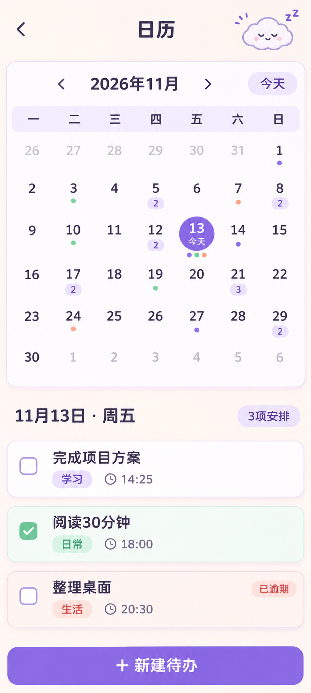

# 咻咿待办 · 日历功能设计方案

## 目标与范围

新增独立的月视图，用户能按日期查看普通待办，点击事件查看详情。日历不显示定时任务；沿用现有本地数据、提醒与完成规则，不单独创建任务副本。

美术稿中的任务、时间、数量与逾期状态仅用于展示布局，实际界面由本机任务数据和当前时间决定。

## 入口与页面

- 在首页右上角“更多”菜单增加“日历”入口，避免窄屏顶部同时挤入搜索、日历和更多三个图标。返回后回到进入前的“我的待办”或“定时任务”列表及筛选状态。
- 顶部显示返回、页面标题“日历”和小云。月份栏含上个月、年月、下个月、“今天”。左右滑动月历切月；点“今天”返回当前月份并选中今天。
- 周一为一周首日，固定七列。相邻月份日期以浅色显示，点击后切换到该月。当天以细紫色轮廓提示；选中日期为紫色实心圆，并用“今天”文字区分选中与当天。
- 日期下方最多显示三个状态点；当天任务超过三个时改为数量标记。状态点颜色：未完成紫、已完成薄荷、逾期蜜桃。数量不含无日期待办和子任务。
- 下半区显示“月日 · 星期”及当天安排数量，按时间从早到晚列出卡片；每张卡片显示标题、带底色的分类标签、时间图标、完成状态，逾期附文字。点击卡片弹出只读详情，提供“编辑”和“关闭”；可在详情中查看子任务进度。底部“＋ 新建待办”打开现有新建页并预填所选日期，保存后回到日历并刷新。
- 当天没有安排时，显示小云和“这一天还没有安排”，底部仍可新建。

## 日期与事件规则

1. 普通待办以**截止时间所在的本地日期**展示；没有截止时间的不进入月历。已完成待办仍留在原截止日期，并以薄荷状态显示。回收站任务不展示。
2. 定时任务及其历史记录均不进入日历；它们继续在独立的“定时任务”页面查看。
3. 日历按手机当前时区划分日期。跨午夜的“提前提醒”只改变通知时间，不改变任务在日历中的归属日。时区或系统日期变化后重新计算可见月份。
4. 当天卡片按事件时间升序排列；时间相同时，沿用用户拖动后的任务顺序。切换首页列表的“未完成/全部/已完成”不会过滤日历。
5. 月份中的状态点与数量使用同一份事件集合计算，避免数字和下方列表不一致。只生成当前可见月份及相邻补位日期，切月时再计算。

## 美术与适配

沿用[移动端界面视觉规范](移动端界面视觉规范.md)：奶油背景 `#FFF9F2`、墨紫正文 `#3B3551`、糖果紫选中 `#8D73E8`、浅薰衣草辅助面 `#F0E9FF`。月历为白色大圆角卡片、淡紫细描边与轻阴影；事件卡片保持现有清单卡片的圆角、标签和勾选样式。小云只作装饰，不覆盖日期和按钮。

- 320–359dp：七列仍完整显示，日期格不放标题，只放状态点或数量；月份栏按钮各至少 48dp，年月文字可缩至单行。
- 360dp 及以上：保留七列网格和单列事件卡片；宽屏增加两侧留白，不把事件压成多列。
- 系统大字体下，日期格保持可点，事件文字与标签允许换行；下半区独立滚动。底部新建按钮避开系统导航栏。
- 日期选中、切月使用约 180–220ms 的轻过渡；系统关闭动画时直接更新。状态不能只靠颜色表达。

## 验收场景

1. 某天有普通待办、已完成待办和定时任务，日期格数量与下方普通待办卡片一致，定时任务不出现；点击卡片可查看正确详情。
2. 无截止日期任务、回收站任务及子任务不会单独出现在月历。
3. 每天和每周定时任务及其历史记录均不出现在日历。
4. 跨午夜提醒、跨月切换、手机时区变化后，任务仍按截止或执行的本地日期显示。
5. 320dp 窄屏及大字体下，七列、月份切换和底部按钮均可操作，日期与卡片文字不重叠。
